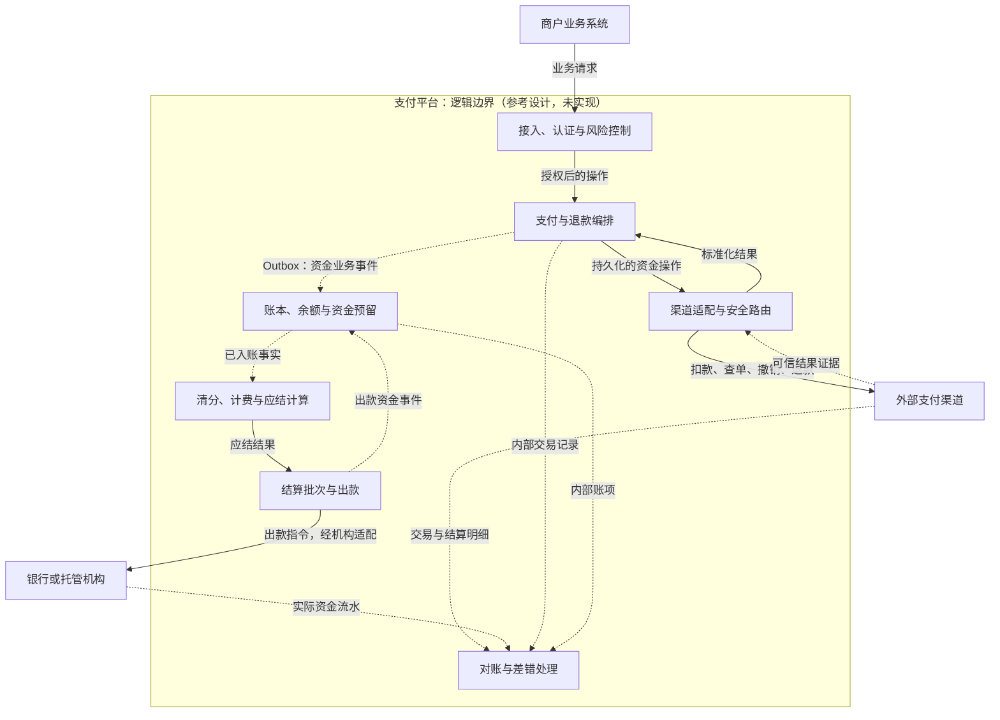

# Payment Core

**支付系统核心架构：交易有状态，账务有约束，资金有去向，异常有闭环。**

Payment systems architecture and design: transaction state machines, idempotency, double-entry ledgers, settlement, reconciliation, and failure recovery.

> **项目状态：设计文档 + 阶段 1/2/3/4 最小实现骨架，不是可运行的支付服务。** 骨架仅覆盖模拟渠道下的受理、发送、查单恢复与投递去重，本地 H2 账套、凭证、余额条件更新、支付待记账与退款额度预留，版本化费用规则、结算批次冻结、模拟出款未知/退回与对账导入去重，以及恢复租约、恢复门禁、地域权威切换、敏感操作审批与审计脱敏；不包含真实渠道、真实银行资金、容量压测、灾备演练或经过验证的金融级保证。所有架构图均为参考设计，而非现有部署拓扑。

## 为什么做这个项目

支付系统不只是“调用扣款接口并等待成功回调”。真正的问题是：在超时、重复请求、乱序通知、服务崩溃和跨机构结算下，如何解释每一笔钱的状态、归属与去向。

本项目围绕三个核心、两类闭环组织：

| 组成 | 回答的问题 | 主要记录 |
| --- | --- | --- |
| 交易核心 | 资金操作执行到了哪一步？ | 支付单、渠道尝试、操作与结果证据 |
| 账务核心 | 谁拥有多少钱、谁欠谁多少钱？ | 凭证、分录、余额与资金预留 |
| 资金核心 | 钱在哪个机构，何时实际划转？ | 清分结果、结算批次、出款与银行流水 |
| 业务闭环 | 收款之后如何撤销、退款或处理争议？ | 独立资金操作、额度占用与状态历史 |
| 核对闭环 | 内部记录与外部资金事实是否一致？ | 对账结果、差错证据与处理工单 |

**请求已受理 ≠ 扣款已成功 ≠ 账本已入账 ≠ 商户已到账。**

## 范围与假设

- 面向商户收款与支付平台的通用参考设计，不试图替代银行核心或卡组织清算网络设计。
- 区分纯支付编排网关与承担商户结算义务的平台；不能将代收资金自动视为平台收入。
- 主链路以单币种、一次性收款为例；授权/捕获、退款、拒付和跨币种边界单独说明。
- 金额使用最小货币单位整数及币种元数据；不假设所有币种都只有两位小数。
- 逻辑模块不等于微服务；后续实现建议先明确事务边界，再决定部署拆分。
- 地区监管、许可资质、资金托管、会计科目和收入确认必须另行核实。

## 核心架构

实线表示业务请求、指令或计算结果；虚线表示异步事件、通知或对账资料，不代表统一传输协议。风险控制是跨操作约束，图中仅简化展示入口。

图源：[核心架构](docs/diagrams/core-architecture.mmd)。展开查看：[支付状态机与超时恢复时序](docs/diagrams/README.md)。

## 阅读路线

| 顺序 | 文档 | 重点问题 |
| --- | --- | --- |
| 1 | [领域边界与架构决策](docs/architecture.md) | 谁拥有状态？哪些操作需要同一事务？ |
| 2 | [支付生命周期](docs/payment-lifecycle.md) | 为什么超时不能判失败？授权、退款和拒付如何拆分？ |
| 3 | [幂等、一致性与恢复](docs/consistency-and-recovery.md) | Outbox/Inbox解决什么？外部扣款为什么不能靠本地回滚？ |
| 4 | [账本与资金不变量](docs/ledger.md) | 如何防重复入账、并发超扣和超额退款？ |
| 5 | [清分、结算与对账](docs/settlement-and-reconciliation.md) | 交易成功之后，资金如何核对并最终到账？ |
| 6 | [可靠性、安全与多活](docs/reliability-and-security.md) | 如何隔离故障、保护敏感数据并安全恢复？ |
| 7 | [故障验证矩阵](docs/validation-matrix.md) | 每项设计用什么故障和断言证明？ |
| 8 | [实现演进路线](docs/roadmap.md) | 如何从模拟核心逐步演进，而非一次搭出大平台？ |
| 9 | [参考资料与证据边界](docs/references.md) | 哪些是官方产品语义，哪些是本项目设计推论？ |

## 十条设计底线

1. **未知不是失败**：超时仅说明本地尚未获得足够结果证据。
2. **重试不是新交易**：同一操作的网络重试保持业务身份和参数不变。
3. **未知时不盲目换渠道**：不同渠道、账户或区域未必共享去重范围。
4. **成功不能由单个 HTTP 状态码决定**：受理、授权、捕获、退款受理、银行到账分别定义。
5. **本地一致性必须落到事务**：业务状态与 Outbox、消费去重与业务效果分别原子提交。
6. **幂等覆盖业务效果**：通知去重不替代唯一凭证、余额约束和渠道操作幂等。
7. **账平不是业务正确**：记错主体、费率或重复入账，也可能借贷平衡。
8. **资金检查与占用原子执行**：不能把先查余额再扣款当作防透支机制。
9. **历史事实不可被覆盖修正**：退款、冲正与差错调整保留原操作及证据链。
10. **异常必须闭环**：长期未知、待记账与对账差错要有责任人、账龄和升级路径。

## 最值得先验证的反例

- 渠道扣款成功、响应丢失，本地超时后向另一渠道重新扣款。
- 同一回调重放，或者不同事件 ID 表达同一个业务结果。
- 凭证已提交但响应丢失，消费者重试导致再次入账。
- 余额 100，两笔并发操作各扣 80，普通“先查后扣”双双通过。
- 并发部分退款合计超过可退额度，或未知退款的占用被提前释放。
- 漏记一笔 100、多记另一笔 100，日汇总相等但逐笔错误。
- 灾备恢复遗漏去重历史，将外部已经执行的操作当作从未执行。

完整故障、观察证据和预期断言见[验证矩阵](docs/validation-matrix.md)。**矩阵是待实现的验收规范，不是已经通过的测试报告。**

## 当前交付与未交付

| 项目 | 状态 |
| --- | --- |
| 领域模型、状态与一致性设计 | 已文档化；尚未通过运行实现验证 |
| 架构图、状态图、恢复时序 | 参考设计，保存 Mermaid 图源 |
| 金额示例、约束与故障验收条件 | 设计示例，不代表会计政策或测试结果 |
| 阶段 1 最小支付核心（模拟渠道、H2、自动化断言） | 已实现骨架；P01—P07、M06—M07 适用断言通过，重启后记录可恢复 |
| 阶段 2 账务与退款核心（本地账本、预留、投影） | 已实现骨架；L01—L08、L10 与 M08—M10 适用断言通过（L09 跨分片在单库骨架中不适用） |
| 阶段 3 清分、结算与对账（模拟银行、报告导入、差错单） | 已实现骨架；S01—S10 适用断言通过；真实渠道结算、真实银行资金与生产对账未实现 |
| 阶段 4 安全与灾备控制骨架（租约、门禁、地域权威、审批、审计脱敏） | 已实现骨架；R01—R05 适用断言通过；容量压测、灾备演练与真实安全/合规审计未执行 |
| 真实渠道与真实资金 | 未实现 |
| 容量压测、灾备演练、安全或合规审计 | 未执行 |

## 如何使用和完善

先选一个明确业务场景，确定资金主体、渠道契约、成功含义和法律边界；再沿阅读路线检查约束及异常路径。不要把文档中的通用状态机械映射成某家渠道的所有支付方式。

修改图时，以 `docs/diagrams/*.mmd` 为图源，并同步 Markdown 中的同名 Mermaid 内容。修改业务设计时，同时检查状态表、金额例子与验证矩阵，避免“图、文、验收条件”相互矛盾。

本仓库未指定开源许可证；公开可读不等于授予任意复制、修改或再分发的许可。
