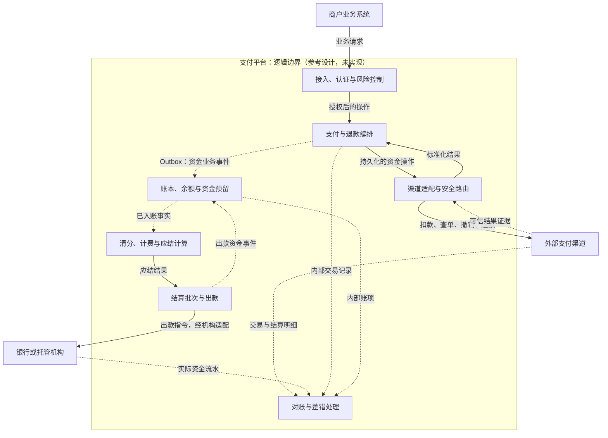
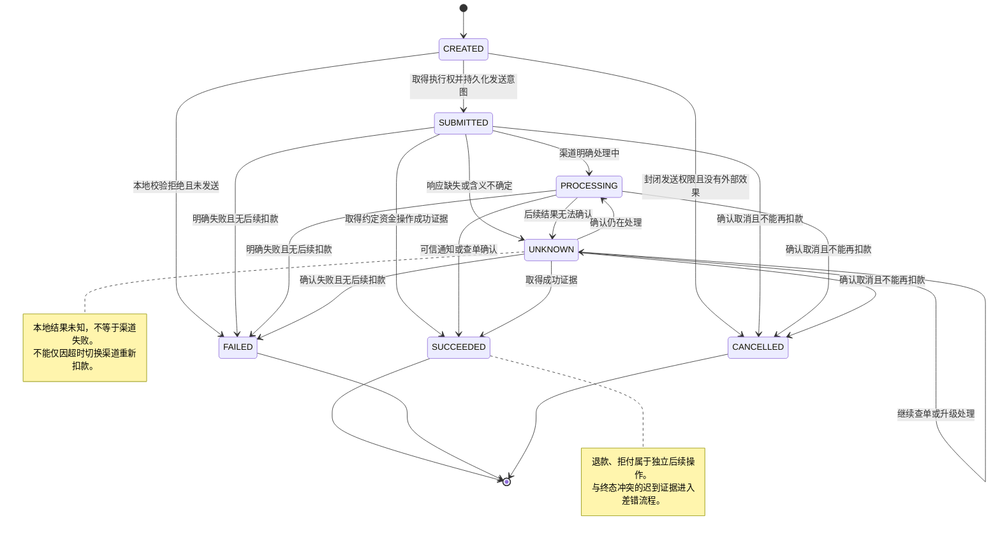
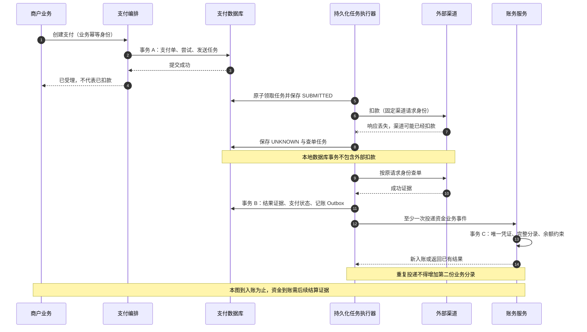

# 架构图集

> 所有图均为参考设计，未实现、未部署。Mermaid 用于 GitHub 原生展示；`.mmd` 文件是可维护图源，Markdown 中的同名图块用于首页阅读。

## 阅读顺序

1. 核心架构：先看交易、账务、资金与核对闭环的边界。
2. 渠道尝试状态：理解 UNKNOWN、终态证据和迟到冲突。
3. 超时恢复时序：理解本地事务、外部扣款与幂等记账的交界。

图不替代正文中的合同前提、渠道契约和[验证矩阵](../validation-matrix.md)。

## 1. 核心架构

实线表示请求、指令或计算结果；虚线表示异步事件、通知或对账资料。风险控制是跨操作约束，图中仅简化展示入口。

图源：[core-architecture.mmd](core-architecture.mmd)。说明：[领域边界与架构决策](../architecture.md)。

## 2. 渠道尝试状态

本图限定收款尝试，不直接套用为退款或拒付状态机。`UNKNOWN` 是本地知识状态；终态后的相反资金证据必须保存并进入差错，而不是被丢弃。

图源：[payment-attempt.mmd](payment-attempt.mmd)。说明：[支付生命周期](../payment-lifecycle.md)。

## 3. 超时恢复时序

本图展示“渠道可能已经扣款、本地响应丢失”的恢复路径，到幂等入账为止；资金到账仍需后续结算与银行证据。

图源：[timeout-recovery.mmd](timeout-recovery.mmd)。说明：[一致性与恢复](../consistency-and-recovery.md)。

## 维护约定

- 修改 `.mmd` 后同步对应 Markdown 图块，避免首页与图源分叉。
- 新增状态、事件或资金门禁时，同步检查状态表、事务边界和验证矩阵。
- 图中不出现真实账户、密钥、商户数据或未经证实的运行指标。
- 本目录不声称图已经通过真实系统验证；当前只进行结构与内容一致性检查。

[返回首页](../../README.md) · [参考资料](../references.md)
